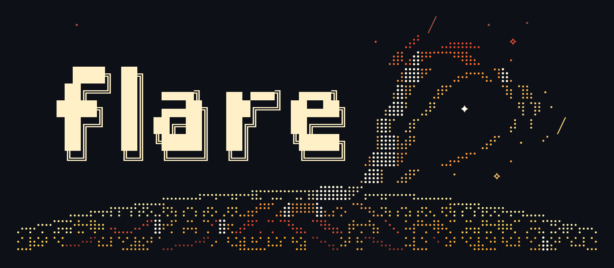

# Branch `kimi31-exl3-live` — one branch that reproduces the running `smart` serve

> **This section describes THIS BRANCH.** It reproduces the serve running on
> this host (turin, `smart` on :8001), package **and** image. The upstream Flare
> project README is preserved below the divider.

| Piece | Identity |
|---|---|
| Package (E1.1) | `gb202-tp8-202611100809` — `sha256(model.safetensors)[:16] = ef06d73556069947`, 752 files under `weights/`, 25 under `deployments/`, TP8, context 396,288 (pool/3) |
| Runtime image | `local/flare:rt-k31exl3-chunkfix-5585a9a7`, image ID `sha256:50bda5a7f78e113cee8a7e566f156ecd50f307408a401f1d3256dd338dd0db0c` |
| Export lineage | tree `b8dcebb50da6bd9acaadeffcd3ea68a3a95a13b8` (merged here) |
| Image lineage | tree `5585a9a76a497478814bdded0ad49081e304be68` (merged here) |
| Merged tip pin | `ae1ea944` (driver `EXPECT_HEAD`) |
| flashinfer | fork `tunamitom/flashinfer`, branch **`kimi31-exl3-live` @ `0aa09dd61`** — auto-cloned to `../flashinfer-k31exl3-live` by the driver if missing, then pinned by resolve guard |
| Serve side | reproduction copies in [`tools/serve/`](tools/serve/README.md) (launcher, unit, healthcheck, seccomp profile) |

## The commands

```sh
bash tools/export-kimi31-exl3.sh --check    # every guard + planner dry-run; prints the exact export command; creates nothing
bash tools/export-kimi31-exl3.sh --detach  # the export (graph-only by default: --reuse-weights), under a transient unit
bash tools/export-kimi31-exl3.sh --image    # the runtime image (docker build from this tree, pinned by image ID)
```

`--link` first if the checkpoint snapshot dir is empty (it populates
`/opt/models/kimi31-exl3-snapshot/Kimi-K3.1-Pro-EXL3-2bit` from the verified
checkpoints below). `--check` must come back clean before `--detach` runs
anything. The export config is the shipped one: ring rows 1024 + BF16 +
trellis shapes + `--prefill-island-reduce`, split-K decode
(`B12X_W4A16_SMALL_M_SPLITK=1`; `B12X_PCIE_DMA_PIECES` and
`IGNITION_KIMI_PREFILL_DMA_*` must be **unset** — the driver refuses any
unaccounted switch environment), capacity 20, image concurrency 1, and the
recipe context 396,288.

After a green export `--detach` records the package path, relinks
`/opt/models/Kimi-K3.1-Pro-EXL3-TP8`, prunes orphan blobs, and asserts the
recorded settings + memory fingerprints (slab 217.69 / index_slab 49.89 MiB,
`Graphs: 66; kernels: 4967` across all 8 ranks).

## W22 decode rows (TP9 transplant) — what rides the export, and the row-1 policy

The W22 combined graph-only export arms, behind the driver's knobs:
`TRELLIS_TABLE=2` (row 5 direct Trellis decode table), `DECODE_FUSION=1` (fused
decode pack + compaction riders), `R3_ISLAND=1` + `R3_ACQUIRE=1` (row 3
two-island head gather, exactly the identity+speed-tested configuration),
`R1_PUSH=1` (row 1 paired-gather push transport with the fused in-kernel expert
select). Row 4's LSE reduce-scatter push stays OFF (speed rule failed), and rows
2/6/7/8/9/10/12 are dropped by the J-A ruling. `plan.concurrency` stays 4 and
`image_concurrency` at the rider 1 (J-E: admission 8 is a documented TODO —
it costs ~0.25 GiB/rank per 4 extra slots (~100-125k KV tokens), needs higher
token capacity + larger graph budget, and the c2/c4 trend does not extrapolate
to c8).

Row 1 is a **numerics-light decode change**, not a byte-identical transport
(J-D). Policy at the switch (`B12X_PCIE_DCP_PAIR_PUSH`, flashinfer) and in the
kimi31 recipe:

- **Ties:** equal selection scores pick the lower expert id — identical in the
  two-step and the fused select.
- **Near-ties:** scores within a few fp32 ULP may rank opposite (the two
  selects use different sigmoid forms; weights land 1-4 ULP apart), so the
  sixteenth expert can differ. Measured rate over 2.4M production-shaped rows
  at 1/4/8 rows: 6.7e-6 boundary swaps (every swapped pair within 2 ULP) and
  5.6e-5 same-set slot-order swaps.
- **Non-finite:** a non-finite router logit is never a candidate in the fused
  select; a row with no finite candidate returns ids 0-15 at weight exactly
  zero. The old two-step path would score `+inf` as sigmoid=1 and select it —
  out of contract (real router logits are finite).
- **Scope:** the fused select engages at 8 rows or fewer — it helps
  single-stream rounds, not packed multi-stream ones.

Owner-bench note: decode in this package is not bit-identical to E1.1 (router
weights within 4 ULP, occasional near-tie expert swaps). Acceptance lengths
within 5% of 3.81 / 2.52 / 2.54 and the decode round against the fit are the
cells that close row 1.

## Full export (no `--reuse-weights`) — for a reproducer without our blob store

The driver defaults to `REUSE_WEIGHTS=1`, which passes `--reuse-weights`: the
export reuses the already-exported weight blobs under
`/opt/models/.flare/packages/blobs` and costs graphs + kernels only. A
reproducer without that blob store runs the **full export**:

```sh
REUSE_WEIGHTS=0 bash tools/export-kimi31-exl3.sh --check    # prints the full-export command (no --reuse-weights)
REUSE_WEIGHTS=0 bash tools/export-kimi31-exl3.sh --detach  # full export: weights + graphs + kernels, ~706 GiB package
```

(`REUSE_WEIGHTS=0` is propagated into the detached unit; `--run` in the
foreground honors it directly.) Expect significant disk and time: the driver
requires >= 800 G free under `/opt/models` and the prepared package is
~706.46 GiB.

**Source checkpoints** (external by nature — deliberately not in the repo;
paths + revisions + hashes only):

| Checkpoint | On-disk location | Revision | Hash-verify |
|---|---|---|---|
| EXL3-2-bit weights (raw checkpoint: 92 `exl3-layer-*` + 96 `retained-model-*` safetensors = 188 shards, 742.235 GiB) | `/storage/models/Kimi-K3.1-Pro-EXL3-2bit` | raw checkpoint `local-inference-lab/Kimi-K3.1-Pro-EXL3-2bit` @ `38fbbe2ba5d46141eaa4d662c128bdf8d810746b`; built from `moonshotai/Kimi-K3.1-Pro` @ `6d0a0202956796543364d666ab19c6ad1a494ee1` (per `construction.json`) | `cd /storage/models/Kimi-K3.1-Pro-EXL3-2bit && sha256sum -c checksums.txt` (188 lines; spot-verified 2026-11-10). Download completion marker: `/storage/models/kimi-k31-exl3-download.done` |
| DFlash2 draft (BF16, 5.2 GiB `model.safetensors` + `config.json`) | `/opt/models/kimi31-draft-dflash2` | `RadixArk/Kimi-K3.1-Dflash2-Preview` @ `ea257b38a8ee755b65287bb8ccd0938b519ce26b` (base model `moonshotai/Kimi-K3.1-Pro` @ `535833b1`, per its README) | `cd /opt/models/kimi31-draft-dflash2 && sha256sum -c SHA256SUMS` (`model.safetensors` = `1e07d2352fc44ea3967862309abeaa670faa3cf386c37adc35b8c97396f27b3f`; verified 2026-11-10) |

The revisions of the **code** the package was exported with are in the export
record's first line (`=== export start … tree b8dcebb5… flashinfer 0aa09dd61…`,
e.g. `export-20261110-144203.log`) and are pinned by the driver's lineage
guards. A reproducer on a different host overrides the `CKPT`/`DRAFT`/`SNAP`
paths in `tools/export-kimi31-exl3.sh` and keeps the revisions above.

## Signing (share-gap 4)

Packages are signed with a **local development key**, and the launcher trusts
that key by **fingerprint**: `TRUST_FP` near the top of
[`tools/serve/start-kimi31-exl3.sh`](tools/serve/start-kimi31-exl3.sh), passed
to the serve as `--dangerously-approve-key "$TRUST_FP"` alongside
`--dangerously-accept-publisher "$TRUST_NS"`. A reproducer signs with **their
own** key and **must change the trusted fingerprint** to their own key's (the
value is `[REDACTED]` in the reproduction copy; the live launcher holds the
owner's). Signature verification stays on everywhere.

## R1a is NOT in this branch (share-gap 6)

This branch/image does **not** contain the R1a host-side stop-verification work.
R1a lives on branch **`levers/r1-stops`** (fork `tunamitom/flare-local-inference`,
`79a8b60c`) and was never merged here or gated under the campaign protocol. As a
consequence, **`stop`-sequences and JSON requests decode at width 1 on this
serve** — accepted for the freeze while traffic sends none; do not read this
branch as reproducing R1a.

## Topology and host prerequisites (share-gap 5)

The tuning in this branch is **this host's**: the prefill DMA-ring pieces table
and the two-island prefill reduce were measured on this box's two-switch layout
(**B and D, 4 + 4 GPUs**), and the launcher resolves GPUs by PCI root port
(80 = B, f0 = D) via `gpu-select.py`. On different topology the ring pieces
table and island split need re-measuring before the numbers transfer.

Host prerequisites observed here (record, not a guarantee elsewhere):

- kernel `7.0.12-vfrebar-vfrebar`; NVIDIA open kernel module driver `610.43.02`;
  SM120/SM121-class GPUs, 8 on switches B+D.
- The drive-link fix: NVMe link policy (`/usr/local/sbin/nvme-link-policy.sh`,
  `nvme-link-policy.service`, dracut conf) — the package drive must not
  mis-train at Gen1 (the launcher fail-closes on a slow link; incident class
  documented in the launcher header).
- Docker + the Rust build toolchain (for `--image`), the export venv
  (`PYV`, uv-synced), ~400 G MemAvailable and >= 800 G free under
  `/opt/models` for an export.
- NUMA pinning as in the launcher (`--cpuset-cpus 0-55,112-167`,
  `--cpuset-mems 1`), prefix-cache disk mount `/dockers/prefix-cache/kimi31-exl3`.

## Honest gaps (share-gap 1 and the rest)

- **The image ID is not reproducible.** `--image` pins the build by image ID
  (`sha256:50bda5a7…`); a fresh `docker build` will not reproduce an image ID
  (base-image drift, timestamps, compiler output), so a reproducer should
  expect `image.id-mismatch` (exit 3) — the pin fails loudly, it never silently
  accepts drift. **`--image-inputs` note (documented only, not implemented this
  run):** pin the *inputs* instead — tree commit (`5585a9a7` lineage, guarded
  by `EXPECT_IMAGE_SRC`), base image digests (`rust:1.94.1-slim-trixie` build
  stage, `debian:trixie-slim` runtime), and `Cargo.lock` — and verify
  **behaviour**: the launch curve is the fingerprint (identical between runs,
  non-decreasing, nominal), not the image ID.
- **Weights are external** (table above): the repo reproduces packages from
  checkpoints it does not carry.
- **Topology tables are this host's** (see above).
- **`--image` has not been exercised end-to-end** (image builds were out of
  scope this campaign window); the first real run is also the first test of
  build determinism.

## Commit metadata (read before any fork goes public)

Do **not** rewrite git history: the commit metadata carries the **owner's
author identity**. Whether that is acceptable is the owner's decision to make
**before** the fork is made public — history rewriting, if ever wanted, is a
separate deliberate act outside this branch's scope.

---

# Flare (upstream project README)

<p align="center">
  
</p>

> **Coding agents:** skip this README and read [AGENTS.md](AGENTS.md) directly.

Flare is a local inference server for NVIDIA SM120/SM121 GPUs, built for
long conversations, coding agents, and repeated tool use. Its goal is to make
the memory, bandwidth, and compute in workstations and compact systems such
as DGX Spark go further, while keeping generation responsive.

This is a research prototype, and is made available via open-source to enable
technical collaboration and collect early feedback.

The design rests on a few principles:

- **Embrace the standard PyTorch ecosystem at build time; serve from Rust.**
  Ignition uses PyTorch, Transformers, and FlashInfer/b12x to load models,
  tune kernels, compile forwards, and capture CUDA graphs into a runtime package.
  Helios, the Rust runtime, serves that package without Python. Compilation and
  graph capture finish before serving.

- **Build on the model ecosystem.** Reuse canonical model implementations
  wherever their dataflow fits, and specialize the parts that need different
  layouts or execution. Model development keeps the tools and libraries that
  make the Python ecosystem productive.

- **Make memory and state explicit.** Plan buffers and execution capacities
  ahead of time. Treat conversation state—including recurrent state alongside
  KV caches—as a whole, so reuse, branching, and resuming preserve it correctly.

- **Keep the runtime small and shared.** Model recipes own model computation;
  the runtime owns scheduling, cache storage, and request handling. A focused
  hardware and kernel stack keeps those boundaries manageable.

[vLLM](https://docs.vllm.ai/en/latest/) covers a much broader range of models,
hardware, and deployment patterns. Flare trades that breadth for a focused
serving contract around selected models and local workloads. Flare is not, and
will never, be a replacement for production inference englines like vLLM.

Think of Flare as a specialized option when its hardware and model coverage
fit your machine.

Start with [model preparation and serving](docs/model-preparation.md).
See the [CLI guide](docs/cli-design.md) for configuration and the
[core design](docs/core-design.md) for the architectural reasoning.

## Licensing and contributions

Flare's project code is licensed under [Apache 2.0](LICENSE). Contributions
require the sign-off described in [CONTRIBUTING.md](CONTRIBUTING.md).
Third-party attributions are listed in [NOTICE](NOTICE); upstream terms remain
applicable to third-party code and assets.

The PyTorch-derived image resizing implementation in `helios/` retains the
[PyTorch BSD-style license](helios/licenses/PyTorch.txt), also distributed with
[Heliopause](heliopause/licenses/PyTorch.txt). The DeepSeek recipe assets retain
their [MIT license](ignition/recipes/deepseek41/assets/LICENSE). The
`heliopause/LICENSE` and `heliopause/NOTICE` symlinks refer to the root files for
Python package distribution.

Upstream chat templates are fetched with the model checkpoints and annotated
locally using bundled insertion patches. Gemma uses pinned Google sources.
The custom Kimi segmented renderer is included as project code. Downloaded
model assets and exported model packages retain their upstream terms; see
[frontend preparation](docs/model-development.md#sampling-and-frontend-metadata).
